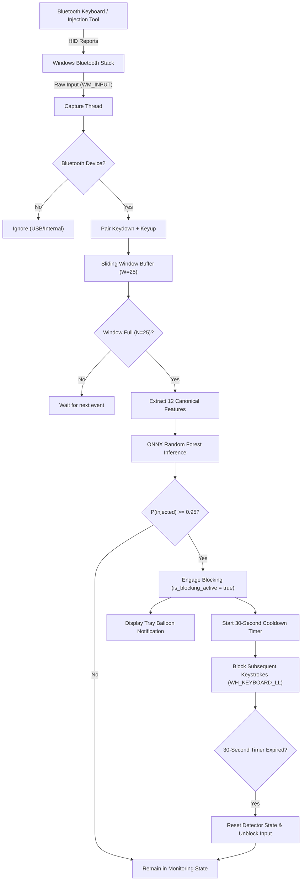
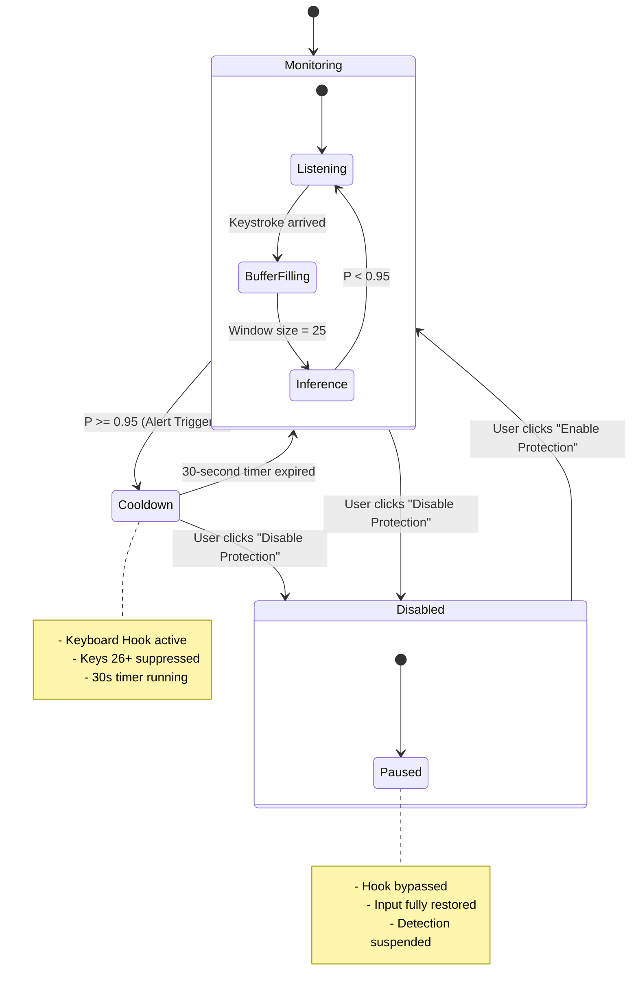
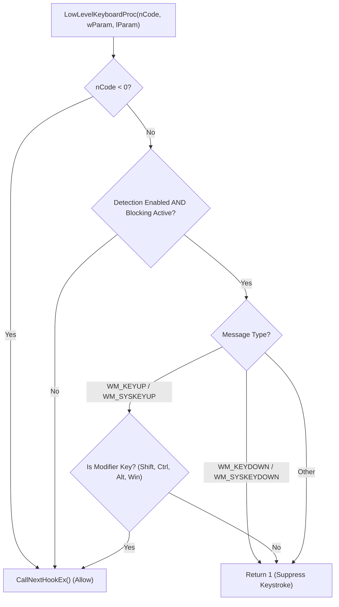

# BadBT: Real-Time Bluetooth HID Keystroke Injection Shield

[](https://microsoft.com/windows)
[](https://isocpp.org/)
[](https://onnxruntime.ai/)
[](#detection-and-ml-pipeline)
[](#post-detection-keyboard-blocking)

BadBT is a lightweight, real-time security daemon and detection framework designed to detect and mitigate **automated Bluetooth HID (Human Interface Device) keystroke injection attacks** on Windows. 

Using **Windows Raw Input** capture, **12-dimensional keystroke dynamics feature extraction**, an embedded **ONNX Random Forest classifier**, and an active **Win32 Low-Level Keyboard Hook (`WH_KEYBOARD_LL`)**, BadBT differentiates human typing rhythms from programmatic keystroke injection payloads (such as those generated by a Flipper Zero in BadBT mode or malicious ESP32 BLE dongles), instantly suppressing subsequent keystrokes upon detection.

---

## Table of Contents

1. [Threat Model & Background](#threat-model--background)
2. [High-Level Architecture](#high-level-architecture)
3. [Detection & ML Pipeline](#detection--ml-pipeline)
   - [Windows Raw Input & Device Filtering](#windows-raw-input--device-filtering)
   - [Sliding Window & Feature Extraction](#sliding-window--feature-extraction)
   - [ONNX Inference & Decision Threshold](#onnx-inference--decision-threshold)
4. [Post-Detection Keyboard Blocking](#post-detection-keyboard-blocking)
   - [Sequential Keystroke Semantics](#sequential-keystroke-semantics)
   - [State Machine & Cooldown Recovery](#state-machine--cooldown-recovery)
   - [Modifier Safety & Hook Design](#modifier-safety--hook-design)
5. [Process Architecture & Thread Safety](#process-architecture--thread-safety)
6. [System Flowcharts](#system-flowcharts)
   - [End-to-End Data Pipeline](#end-to-end-data-pipeline)
   - [Detector State Machine](#detector-state-machine)
   - [Low-Level Keyboard Hook Decision Flow](#low-level-keyboard-hook-decision-flow)
7. [Directory Structure](#directory-structure)
8. [Engineering & Build Guide](#engineering--build-guide)
   - [Prerequisites](#prerequisites)
   - [Building From Source](#building-from-source)
   - [Running the Test Suites](#running-the-test-suites)
   - [Packaging the Windows Installer](#packaging-the-windows-installer)
9. [CLI & Application Usage](#cli--application-usage)
10. [Future Directions](#future-directions)

---

## Threat Model & Background

### The Attack Vector
Modern operating systems inherently trust Human Interface Devices (HIDs) such as keyboards and mice. Attack tools—such as the **Flipper Zero** running BadBT/BadUSB firmware, Raspberry Pi Zero W, or custom ESP32 BLE dongles—can pair over Bluetooth Classic or Bluetooth Low Energy (BLE) and present themselves as standard HID keyboards.

Once paired, these devices can execute pre-programmed attack scripts (e.g., DuckyScript) at superhuman speeds, launching administrative PowerShell shells, downloading malicious payloads, or modifying credentials within seconds.

```
+------------------------+      BLE HID Reports       +--------------------------+
| Attacker Device        | -------------------------> | Target Windows Desktop   |
| (Flipper Zero / ESP32) |                            | (Implicit OS HID Trust)  |
+------------------------+                            +--------------------------+
```

### The Literature Gap
- **Network/Protocol-Layer Defenses**: Traditional Bluetooth security mechanisms focus on RF/link-layer attacks (BLE pairing spoofing, BlueBorne, relay attacks, DoS). They do not inspect or evaluate input authenticity once a device is paired.
- **USB HID Defenses**: Prior behavioral detection frameworks (e.g., QUACK, HID Detector) focus on USB bus properties.
- **BadBT Solution**: BadBT operates at the **OS input layer**, evaluating temporal dynamics across keystrokes specifically originating from Bluetooth HID devices. It detects injection regardless of payload variants (max-speed, fixed delay, or jittered/random delay).

---

## High-Level Architecture

BadBT is composed of three primary subsystems:

1. **Capture Subsystem (`capture/`)**: Registers for Windows Raw Input events (`WM_INPUT`), extracting hardware device paths (`RIDI_DEVICENAME`) and identifying whether the originating keyboard is connected via Bluetooth (`BTHENUM` or `BTHLEDevice`).
2. **Detection Core (`detector/`)**: Evaluates a sliding window of 25 completed keydown/keyup pairs, derives a 12-dimensional keystroke dynamic feature vector, and runs inference via the embedded ONNX Runtime Random Forest classifier.
3. **Tray Shield Daemon (`tray/`)**: The production desktop background service (`badbt-tray.exe`). Hosts the UI message loop, renders native taskbar tray icons and notifications, owns the authoritative detector instance, and installs the `WH_KEYBOARD_LL` low-level keyboard hook that suppresses malicious input.

---

## Detection & ML Pipeline

```
Raw Input (WM_INPUT)
        |
        v
Bluetooth Device Filter
        |
        v
Keydown/Keyup Pairing (Hold & Flight Times)
        |
        v
Sliding Window (W = 25 Keystrokes, Step = 1)
        |
        v
Feature Extraction (12 Canonical Features)
        |
        v
ONNX Runtime Random Forest (badbt_rf_v1.onnx)
        |
        +---> P(injected) < 0.95  ==> Monitoring (Input allowed)
        |
        +---> P(injected) >= 0.95 ==> ALERT! Cooldown Active & Blocking Engaged
```

### Windows Raw Input & Device Filtering
Unlike standard keyboard hooks or `WM_CHAR` handlers, the **Windows Raw Input API** (`RegisterRawInputDevices`) provides direct access to the device handle (`HANDLE hDevice`) associated with each hardware input report.

Using `GetRawInputDeviceInfoW(..., RIDI_DEVICENAME, ...)`, BadBT resolves device interface paths:
- **Bluetooth Classic**: `\\?\HID#{00001124-0000-1000-8000-00805f9b34fb}...` or paths containing `BTHENUM`
- **Bluetooth Low Energy (BLE)**: `\\?\HID#{00001812-0000-1000-8000-00805f9b34fb}...` or paths containing `BTHLEDevice`
- Keystrokes from non-Bluetooth devices (USB, built-in laptop keyboards) are ignored by default unless explicitly configured via `--all-keyboards`.

### Sliding Window & Feature Extraction
Keystroke events are paired into `PairedKeystroke` structs measuring:
- **Dwell Time ($T_{\text{dwell}}$)**: $\text{Timestamp}_{\text{keyup}} - \text{Timestamp}_{\text{keydown}}$
- **Flight Time ($T_{\text{flight}}$)**: $\text{Timestamp}_{\text{keydown}_i} - \text{Timestamp}_{\text{keyup}_{i-1}}$

A rolling buffer maintains a window of **25 paired keystrokes** ($W=25$, step size $S=1$). When the buffer is full, the [FeatureExtractor](file:///D:/projects/capstone/bluetooth2/detector/src/feature_extractor.cpp) computes the canonical **12-feature vector**:

| Index | Feature | Description |
|:---:|:---|:---|
| `0` | `mean_dwell` | Mean key dwell time in milliseconds |
| `1` | `std_dwell` | Sample standard deviation ($ddof=1$) of dwell times |
| `2` | `cv_dwell` | Coefficient of variation of dwell times ($\sigma / \mu$) |
| `3` | `n_dwell_outliers` | Number of key dwell events exceeding 2000 ms cap |
| `4` | `mean_flight` | Mean flight time between consecutive keystrokes (ms) |
| `5` | `std_flight` | Sample standard deviation of flight times |
| `6` | `cv_flight` | Coefficient of variation of flight times ($\sigma / \mu$) |
| `7` | `n_pauses` | Number of inter-key flight pauses exceeding 2000 ms |
| `8` | `autorepeat_ratio` | Ratio of OS-generated autorepeat keystrokes in window |
| `9` | `backspace_ratio` | Ratio of correction keys (`VK_BACK`, `VK_DELETE`) |
| `10` | `events_per_sec` | Keystroke throughput rate over the window duration |
| `11` | `n_devices_in_window` | Number of distinct input devices contributing to window |

### ONNX Inference & Decision Threshold
- Model: Trained **Random Forest Classifier** exported to ONNX format ([`model/badbt_rf_v1.onnx`](file:///D:/projects/capstone/bluetooth2/model/badbt_rf_v1.onnx)).
- Decision Threshold: **$P(\text{injected}) \ge 0.95$**.
- Operating with a high decision threshold of 0.95 ensures near-zero false positives during normal high-speed human typing (e.g., coding, gaming, rapid text transcription).

---

## Post-Detection Keyboard Blocking

### Sequential Keystroke Semantics
Because the machine-learning pipeline requires a 25-keystroke sliding window to compute statistical features and classify an attack:

```
Keys 1 to 24:   Buffered & processed (allowed through to active applications)
Key 25:         Detection trigger (evaluated by ONNX model; P >= 0.95)
Keys 26+:       BLOCKED immediately (suppressed by WH_KEYBOARD_LL hook)
```

> [!NOTE]
> This is a **post-detection containment mechanism**, not pre-execution prevention. It bounds the damage of automated attacks by immediately halting automated command execution (e.g., stopping an injected script from completing an administrative command string or downloading a second-stage payload).

### State Machine & Cooldown Recovery
The detector operates as a finite state machine:

1. **`Monitoring`**: Default state. Protection is active, Raw Input is monitored, and keystrokes pass through freely.
2. **`Cooldown`**: Entered immediately when $P(\text{injected}) \ge 0.95$.
   - `is_blocking_active_` flag is set to `true`.
   - Windows desktop notification alert is displayed.
   - A **30-second cooldown timer** (`COOLDOWN_TIMER_ID`) is armed on the UI thread.
   - All subsequent keyboard input (Keys 26+) is suppressed by returning `1` in the hook.
3. **Recovery (`Cooldown -> Monitoring`)**:
   - When the 30-second cooldown timer expires, BadBT clears internal pairing state, resets `is_blocking_active_ = false`, and returns to `Monitoring`.
   - Legitimate keyboard input is immediately restored.
4. **Manual Bypass (`Disabled`)**:
   - If the user clicks "Disable Protection" in the tray context menu or UI dialog, `detection_enabled_` is set to `false`.
   - The hook procedure checks `!app->is_detection_running()` and immediately bypasses blocking (`CallNextHookEx`), restoring manual control.

### Modifier Safety & Hook Design
A major pitfall of low-level keyboard hooks (`WH_KEYBOARD_LL`) is the "sticky modifier key" problem: if a user or script presses <kbd>Shift</kbd>, <kbd>Ctrl</kbd>, <kbd>Alt</kbd>, or <kbd>Win</kbd> and the hook unconditionally suppresses all subsequent events, the corresponding `WM_KEYUP` message is dropped. The Windows OS keyboard state remains convinced that the modifier is still held down.

BadBT avoids this by inspecting key event types inside [`TrayApp::low_level_keyboard_proc`](file:///D:/projects/capstone/bluetooth2/tray/src/tray_app.cpp#L36-L62):

```cpp
// Allow modifier KEYUP events to pass through even during active blocking
if (wParam == WM_KEYUP || wParam == WM_SYSKEYUP) {
    if (lParam != 0) {
        auto* kbd = reinterpret_cast<const KBDLLHOOKSTRUCT*>(lParam);
        if (is_modifier_key(kbd->vkCode)) {
            return CallNextHookEx(nullptr, nCode, wParam, lParam);
        }
    }
    return 1; // Block non-modifier keyups
}
```

This guarantees that:
- Injected alphanumeric and navigation keystrokes are blocked.
- Any released modifier key is received by the OS, preventing stuck modifier states.

---

## Process Architecture & Thread Safety

BadBT follows a strictly partitioned multi-threaded architecture:

```
+-----------------------------------------------------------------------------------------+
|                                    badbt-tray.exe                                       |
|                                                                                         |
|  +-------------------------------------+       +-------------------------------------+  |
|  |             UI Thread               |       |       Background Capture Thread     |  |
|  |                                     |       |                                     |  |
|  | - Win32 Message Loop (GetMessageW)  |       | - Hidden message window             |  |
|  | - Owns HWND and Tray Icon           |       | - RegisterRawInputDevices           |  |
|  | - Installs/Uninstalls Hook          |       | - Device path caching               |  |
|  | - Owns Cooldown Timer               |       | - Autorepeat filtering              |  |
|  | - Renders Status UI                 |       | - Feeds detector->process_event()   |  |
|  +-------------------------------------+       +-------------------------------------+  |
|                     ^                                             |                     |
|                     | PostMessageW(hwnd, WM_DETECTOR_ALERT)       |                     |
|                     +---------------------------------------------+                     |
|                                                                                         |
|  Shared Atomic State (Lock-Free Read in Hook Callback):                                 |
|    - std::atomic<bool> is_blocking_active_{false}                                       |
|    - std::atomic<bool> detection_enabled_{true}                                         |
|    - std::atomic<TrayApp*> s_instance_{nullptr}                                         |
+-----------------------------------------------------------------------------------------+
```

### Critical Concurrency Invariants
- **Hook Speed**: The `WH_KEYBOARD_LL` hook runs synchronously in the Windows input dispatch chain. It **never** takes locks, allocates memory, logs to console, or performs file/network I/O. It performs only a fast atomic boolean check.
- **Hook Ownership**: The hook is installed via `SetWindowsHookExW` and uninstalled via `UnhookWindowsHookEx` exclusively from the UI thread, which hosts the standard `GetMessageW` message pump.
- **Clean Shutdown Order**:
  1. `is_blocking_active_.store(false)`
  2. `UnhookWindowsHookEx(hook_)`
  3. `s_instance_.store(nullptr)`
  4. Signal capture thread to terminate and `join()`
  5. Destroy UI windows and notify icon.

---

## System Flowcharts

### End-to-End Data Pipeline



### Detector State Machine



### Low-Level Keyboard Hook Decision Flow



---

## Directory Structure

```text
bluetooth2/
├── capture/                    # Raw Input capture library & CLI
│   ├── include/
│   │   ├── device_info.h       # Windows device path parsing & Bluetooth detection
│   │   └── raw_input.h         # Raw input window creation & message pump
│   └── src/
│       ├── device_info.cpp
│       ├── raw_input.cpp
│       └── main.cpp            # badbt-capture.exe tool
├── detector/                   # Core ML inference & detection logic
│   ├── include/
│   │   ├── detector.h          # LiveDetector state machine
│   │   ├── feature_extractor.h # 12-feature sliding window extraction
│   │   ├── model_runner.h      # ONNX Runtime wrapper
│   │   └── path_utils.h        # Model path resolution helpers
│   ├── src/
│   │   ├── detector.cpp
│   │   ├── feature_extractor.cpp
│   │   ├── model_runner.cpp
│   │   ├── path_utils.cpp
│   │   └── main.cpp            # badbt-detector.exe diagnostic CLI
│   └── tests/
│       ├── test_feature_parity.cpp
│       └── test_onnx_inference.cpp
├── tray/                       # Production desktop tray daemon & shield
│   ├── include/
│   │   ├── notification.h      # Win32 Shell_NotifyIcon helpers
│   │   └── tray_app.h          # TrayApp class, WH_KEYBOARD_LL hook & UI
│   ├── src/
│   │   ├── notification.cpp
│   │   ├── tray_app.cpp
│   │   └── main.cpp            # badbt-tray.exe entry point
│   └── tests/
│       └── test_tray_state.cpp # Lifecycle and mock hook test suite
├── installer/                  # Inno Setup packaging scripts
│   └── badbt_setup.iss         # Inno Setup 6 installer definition
├── dist/                       # Packaged distribution artifacts
│   ├── BadBT-1.0.2-Setup.exe   # Final production installer
│   └── badbt-tray.exe          # Production executable
├── model/                      # Trained ONNX models
│   ├── badbt_rf_v1.onnx
│   └── rf_model.onnx
├── data/                       # Datasets & offline captures
│   ├── raw/                    # Offline session logs (*.jsonl)
│   └── splits/                 # Train/test partitions
└── CMakeLists.txt              # Top-level CMake build configuration
```

---

## Engineering & Build Guide

### Prerequisites

| Dependency | Minimum Version | Purpose |
|:---|:---|:---|
| **Windows OS** | Windows 10 (Build 1809+) or Windows 11 | Target operating system |
| **C++ Compiler** | GCC 12+ (MSYS2 UCRT64) or MSVC 2019+ | C++17 support |
| **CMake** | 3.20+ | Build system generator |
| **ONNX Runtime** | 1.16+ | C++ inference engine (included in repo) |
| **Inno Setup** *(Optional)* | 6.2+ | Building installer packages |

### Building From Source

1. **Open MSYS2 UCRT64 terminal (or PowerShell configured with UCRT64 in `PATH`):**
   ```powershell
   $env:PATH = "C:\msys64\ucrt64\bin;" + $env:PATH
   ```

2. **Configure with CMake in Release mode:**
   ```powershell
   cmake -B build -S . -DCMAKE_BUILD_TYPE=Release
   ```

3. **Build the production targets:**
   ```powershell
   # Build the system tray shield (badbt-tray.exe):
   cmake --build build --target badbt-tray --config Release

   # Build all targets (shield, CLI detector, and tests):
   cmake --build build --config Release
   ```

Upon completion, all binaries and DLLs will be located in:
- `build/tray/badbt-tray.exe`
- `build/detector/badbt-detector.exe`
- `build/capture/badbt-capture.exe`

### Running the Test Suites

#### 1. Unit & State Machine Lifecycle Tests
Tests hook installation, cooldown recovery, toggle bypass, and callback behavior:
```powershell
& "build/tray/test_tray_state.exe"
```
*Expected: `11 / 11 tests passed (100% PASS)`*

#### 2. ONNX Inference Regression Tests
Verifies feature extraction parity and model inference:
```powershell
& "build/detector/test_onnx_inference.exe"
```
*Expected: `100% PASS` on baseline datasets.*

### Packaging the Windows Installer

To produce a single self-extracting installer (`dist/BadBT-1.0.2-Setup.exe`):
```powershell
& "C:\Users\<user>\AppData\Local\Programs\Inno Setup 6\iscc.exe" /F"BadBT-1.0.2-Setup" "installer/badbt_setup.iss"
```

The resulting package will be created in [`dist/`](file:///D:/projects/capstone/bluetooth2/dist/).

---

## CLI & Application Usage

### Running the System Tray Shield (`badbt-tray.exe`)

The production application runs quietly in the system tray. Right-clicking the shield icon opens the status and control menu.

```powershell
# Standard production execution (monitors Bluetooth keyboards):
& "build/tray/badbt-tray.exe"

# Monitor all keyboards (useful for testing on USB/laptop keyboards):
& "build/tray/badbt-tray.exe" --all-keyboards

# Offline replay mode (simulates attack from recorded JSONL log):
& "build/tray/badbt-tray.exe" --replay data/raw/inj_01_zerodelay_01.jsonl

# Specify a custom ONNX model:
& "build/tray/badbt-tray.exe" --model model/badbt_rf_v1.onnx
```

### CLI Diagnostic Tool (`badbt-detector.exe`)

A command-line diagnostic tool for real-time monitoring and raw event inspection:

```powershell
# Live monitoring of Bluetooth input:
& "build/detector/badbt-detector.exe"

# Replay an offline capture log and print classification results per window:
& "build/detector/badbt-detector.exe" --replay data/raw/inj_01_zerodelay_01.jsonl
```

---

## Future Directions

1. **Hardware-Specific Per-Device Blocking (Kernel WDF Filter)**:
   - *Current*: `WH_KEYBOARD_LL` is a global user-mode hook; when active, it suppresses keyboard events across the entire desktop session.
   - *Future*: A Windows Kernel-Mode Driver (WDF Keyboard Class Filter Driver) can inspect the originating hardware PDO (`Physical Device Object`) and drop reports exclusively from the malicious Bluetooth device, allowing concurrent typing on a trusted USB keyboard.
2. **Dynamic / Adaptive Window Sizes**:
   - Investigate early stopping classifiers ($W = 10, 15, 20$) for high-confidence, zero-delay injection attacks to reduce the detection latency below 25 keystrokes.
3. **Cross-Platform Portability**:
   - Port the Raw Input capture layer to **macOS** (`IOHIDManager`) and **Linux** (`evdev` / `libinput`). The feature extraction and ONNX model pipeline are already portable C++17.
4. **Active Bluetooth Disconnection**:
   - Integrate the Windows Bluetooth API (`BluetoothAuthenticateDevice`, `BluetoothRemoveDevice`) to programmatically unpair and disconnect the malicious Bluetooth device upon detection.
5. **Enterprise Telemetry & SIEM Forwarding**:
   - Add structured Windows Event Log (ETW) provider emission for SIEM (Splunk, Sentinel) alerting on keystroke injection attempts across enterprise endpoints.
